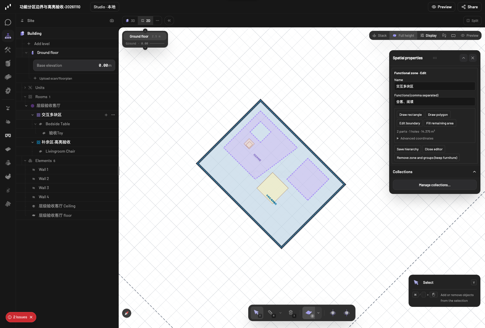
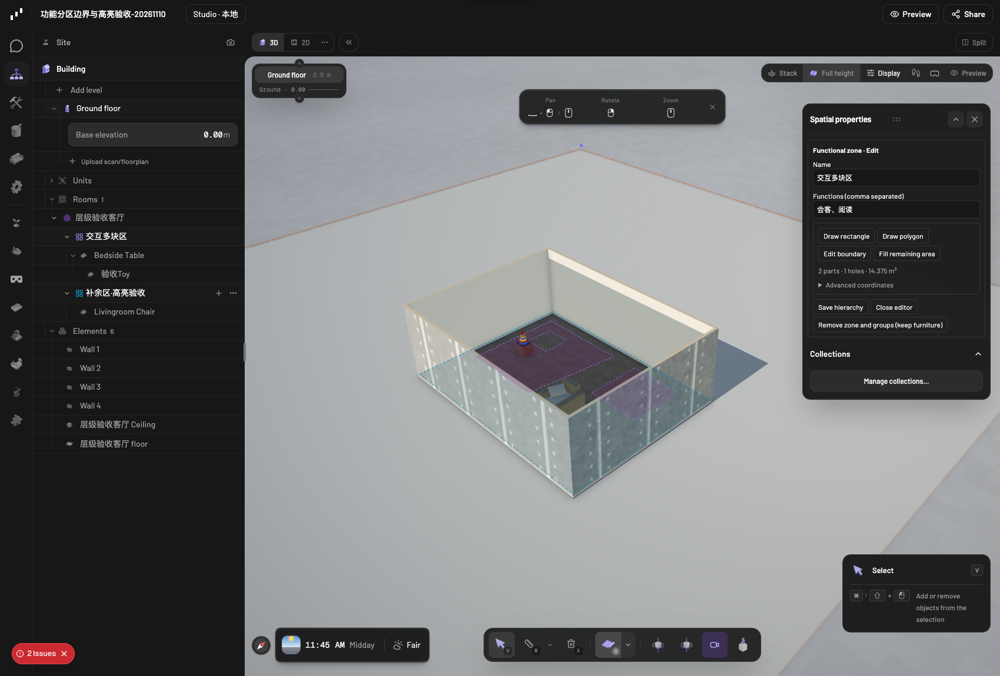

# 功能分区：公共边界与归属高亮

基线 `062488fbaa9cb41600f2d9b503f39dbda59ee7c6`，分支 `codex/functional-zone-boundaries`。本次仅调整编辑器的显示与选择路径，不修改 schema、Qwen 工具、分区轮廓、家具变换或承托 `parentId`。

## 显示和操作

- 同一平面上的公共边界只画一次。反向轮廓、不同起点、额外共线顶点和部分重合线段均会先分段再去重；主轮廓、孔洞和附加分块使用同一逻辑。
- 保存后的边界统一为虚线。2D 使用统一相位的 SVG 虚线，3D 使用实际带间隙的 WebGPU LineSegments。短边拆分后仍沿同一世界坐标相位绘制，不会被两条反向虚线拼成实线。
- 不同分区使用不同显示色。同色节点自动分配替代色；明确不同的原颜色保留。显示色、悬停和选中状态不写回场景数据。当前可见分区集合不变时，刷新保持配色。
- 未强调的共享边使用中性色；悬停或选中时切换到归属分区的颜色。选中分区的填色更明显，2D 边线也加粗，仍然保持虚线。
- 悬停 Scene 分区行、2D 标签或边界会联动高亮。2D 公共边的提示列出两侧名称；点击公共边轮换选择归属，点击标签或 Scene 行直接选中指定分区并打开属性面板。
- 3D 边界也支持鼠标悬停和点击，选择沿用原生节点的释放时选择策略。Scene 行的悬停/选择在 3D 同步高亮。
- 分区填色不捕获家具点击。绘制、移动、相机拖动和捕获等状态保留已有输入所有权；本次不增加通过填色整体拖动分区的操作。

几何去重只处理显示线段，不改变物理场景或语义关系。处于不同地面标高的区域不会被合并成同一条 3D 边界。显示去重的米制容差为 `1e-8`，不会回写到坐标。

## 验收与证据

独立项目“功能分区边界与高亮验收-20261110”复制自此前的验收种子，所有写入只发生在这份新项目中。脚本与小型收据在 `local-ai/zone-boundary-tests/`，截图在 `docs/media/functional-zone-boundaries/`。

- 七组纯几何/配色测试覆盖反向和局部重边、截图中多分块/孔洞与补余区重边、标高差异、虚线相位及原始数据不变。
- 选择管理器测试覆盖共享边轮换、属性面板、绘制/捕获/相机拖动时禁用拾取、悬停清理、右键和 3D 释放/DOM click 不重复选择；连同既有家具归属和整体变换测试执行。
- 真实浏览器检查 16 条唯一边界，其中 12 条共享边，2D 每条只有一个虚线描边。不同分区填色不同，悬停、Scene/标签选择和公共边轮换均实测。
- 通过原有属性面板保存验收分区名称，刷新后名称保留、配色稳定，2D/3D 切换后选择和孔洞/分块显示正常。
- WebGPU 中对应 16 个唯一 LineSegments 对象，实际线段之间有间隙。填充三角面的总面积仍为 48 m²，分块/孔洞没有变化。
- 逐字段对比所有原有节点：除了新验收项目中明确保存的一个分区名称，其余节点及全部几何完全一致。38 项相关单元测试通过。任务前已有的 19 个项目完整 graph 也完全未变。

类型与暂存文件检查结果、浏览器收据及原项目保护结果见验收目录。本次新增界面内容仅使用场景名称，没有新增翻译条目。国际化目录同步通过；全仓 literal guard 仍报告基线已有的 editor-navbar、local-chat、local-studio、scene-loader 四个页面，本分支未修改它们，未绕过检查。开发环境仍可能记录既有 React/drei 同步 unmount 控制台警告；单独记录，不等同于未处理的 pageerror。

