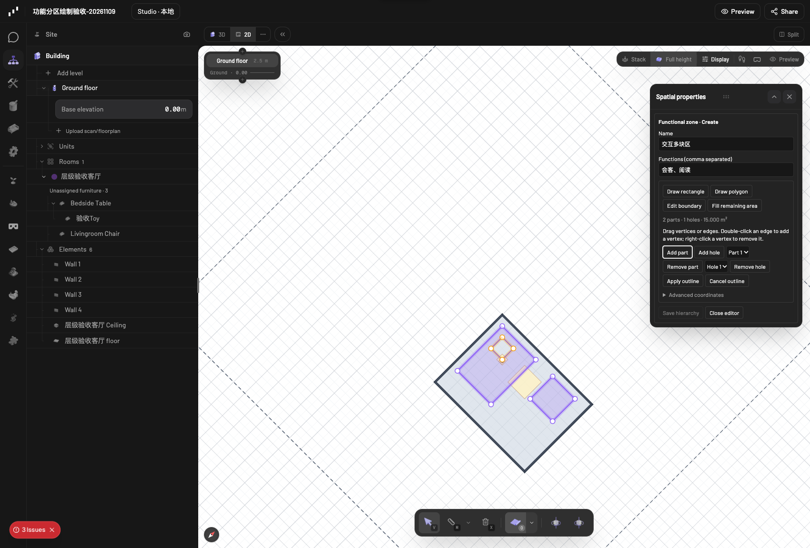

# 功能分区交互式绘制

本次从 `e072b7cd401ec1b3c3f582e3a09c917b6d1912e4` 新建 `codex/functional-zone-drawing`。不改变既有家具布局、承托父子关系或家具组团模型。

## 使用

1. 在 Scene 房间行右侧加号或右键菜单选择 **Add functional zone**，填写名称。
2. 属性面板选择 **Draw rectangle** 拖出矩形，或 **Draw polygon** 逐点单击。点首点或 Enter 闭合，Backspace 撤回最后一点，Esc 取消。
3. **Edit boundary** 可拖动顶点、拖动整条边、双击边加点、右键顶点删点。边界可吸附房间顶点、房间边和网格；越界、自交或无效孔洞不会提交。
4. **Add part** 为同一分区增加独立分块；选择 Active part 后，**Add hole** 在该块内挖孔。支持多个分块和多个孔洞，以及在孔洞内形成独立岛屿。
5. **Fill remaining area** 预览“房间减去已有功能分区的并集”。编辑既有分区时只排除它自身；房间原有孔洞也被扣除。结果保留全部分块和孔洞。
6. **Apply outline** 一次提交，支持原生撤销/重做。取消预览不写场景。预览后房间/其他分区被修改时拒绝应用过期结果。

## 数据与 AI

一个 `functional-zone` ID 对应主轮廓 `polygon`、主轮廓 `holes` 和附加分块 `parts: [{polygon, holes}]`。`parts` 不重复包含主轮廓。新增字段默认为空，旧单轮廓场景可直接读取。家具组团仍通过原来的功能分区 ID 引用；承托仍使用原家具 `parentId`。

Qwen 与 MCP 使用相同接口：

- `get_functional_zone_remainder({roomId, excludeId?})`：只读预览，返回全部分块、孔洞、面积和 empty。新增分区不传 excludeId；重绘既有分区时仅排除该分区自身。
- `edit_functional_zone({roomId, name, polygon, holes, parts})`：创建复杂分区；编辑时传 id，省略字段保持原值。
- `edit_functional_zone({roomId, name, fillRemaining:true})`：基于最新场景计算并创建补余分区；编辑补余传 id。不能与显式几何同时传入。
- `list_functional_zones`、`get_spatial_hierarchy`：读取复杂分区和家具归属；孔洞内点不算在分区内。

可向 Qwen 说：“读取当前房间，创建会客区并在其中留出柱子的孔洞；再预览剩余区域，把剩余所有分块保存为同一个通行区。不要移动家具。”

## 算法来源

复用了现有 Label Studio 定制版的环校验、稳定面积和浮点碎片判定，并移植七组几何回归案例。预期结果由原 Label Studio 实现生成，再用于 Pascal 的回归比较，包含孔洞、多余块、凹多边形、重叠家具与窄余区。坐标从图片百分比改为楼层局部米制。Pascal 原生保存孔洞，不使用 Label Studio 为结果存储而做的三角化分解。来源与许可证见 `docs/third-party/label-studio/`。

2D 使用 even-odd 填充；3D 使用真实带孔轮廓三角化。3D 轮廓使用 WebGPU 支持的闭合 Line，而非不受支持的 LineLoop，并随房间地面实际标高显示。分区是编辑辅助图层，不作为实体建筑导出或进入 Studio 纯场景捕获。

## 验收

可复查脚本与收据见 `local-ai/zone-drawing-tests/`，截图见 `docs/media/functional-zone-drawing/`。所有写操作在两份新建验收项目中执行。

- 475 项相关测试通过：新几何/绘制测试、既有层级和整体变换测试、原生节点 union/编译解析器、MCP 只读工具标注。
- 浏览器真实鼠标：矩形、多边形、加孔/加块、顶点/边拖动、增删顶点、预览取消、越界和自交拒绝、补余、原生撤销/重做、刷新、2D/3D。
- 实际 3D 三角面的面积合计为 48 m²，与房间一致；全部孔洞及分块保留。
- 房间已覆盖和并发修改导致的过期预览均拒绝提交。
- 真实本地 Qwen 创建两个逻辑分区，多分块/孔洞保存正确。第一次新增补余预览误用了排除参数，后端提交按最新场景正确计算；已明确工具说明并追加只读复核，只读复核已正确返回新增分区余量 0 m²、重绘自身余量 33 m²。复核时模型曾虚构 ID，被工具拒绝后自行查询真实 ID 并恢复；不宣称每次调用均无错误。
- 家具和承托节点逐字段不变；任务前已有的 17 个项目完整 graph 对比完全一致。
- core/MCP/nodes 构建与 editor 类型检查通过。新增翻译以 AI 草稿保存；英文和伪语言已编译，尚未经人工语言审校。

全量 `i18n:check` 的目录同步检查通过，但 literal guard 仍报基线中已有的四个本地接入页面：editor-navbar、local-chat、local-studio、scene-loader。本任务未修改这四个文件，未屏蔽或绕过检查。因此不宣称全量 CI 全绿。

3D 画面复查已确认边界/孔洞可见。浏览器仍记录基线 React/drei 同步 unmount 控制台警告；本次主交互测试与边界测试的未处理 pageerror 均为零。
