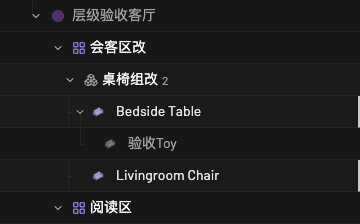
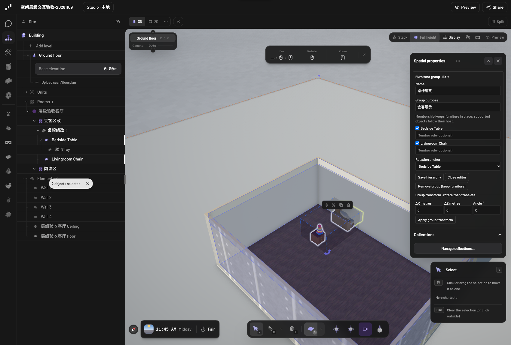

# Spatial hierarchy interaction update

Base: `ec5bbdbfa6c88f340c54406c1bb6e2fa8cbe37ea`.
Review branch: `codex/spatial-hierarchy-ux`.

## Interaction

- Room, functional-zone and furniture-group rows have context menus. Hover or keyboard focus reveals compact plus/ellipsis actions; the tree no longer contains permanent Edit, Add Group, Undo or Redo rows.
- Click a zone/group to open a native right-side inspector card. Double-click a semantic row or use Rename/F2 for inline naming. Escape cancels inline naming. A keyboard-focused ellipsis menu offers the same actions as right-click.
- Multi-select furniture and right-click its tree row to create a furniture group in an existing functional zone. Selection is prefilled; furniture already assigned elsewhere is excluded. Membership can also be edited in the properties card.
- Select a group in the tree, then drag the dashed selection box or its explicit move handle to move it. In 2D, drag a corner rotation handle; in 3D, drag the rotation arrow. Native snapping, live previews, cancellation and global history remain in use. A persistent group with one support root also gets these controls. Rotation uses the stored group anchor, including a hosted anchor's inherited scale/rotation; without an anchor it uses the mean of support-root origins, matching the agent operation.
- Drag a furniture group onto a functional-zone row to change its semantic parent. Drag furniture onto a furniture-group row to transfer its membership. Dragging a supported object assigns its entire support family, preserving the physical support tree. Existing member roles transfer with their furniture. An emptied source group is removed as part of the same undo step.
- Each hierarchy change and committed canvas gesture is one global undo step (`Cmd/Ctrl+Z`, `Cmd/Ctrl+Shift+Z`). There are no hierarchy-only history controls.

## Data invariants

Schema and Qwen tool contracts are unchanged. Functional zones/groups remain independent native semantic nodes. A drop only updates/removes furniture-group records: it never changes any furniture position, rotation, scale, asset or `parentId`. A canvas transform changes movable support roots only; their hosted children keep their local poses. Invalid drops or cross-level membership fail before applying changes. An open inspector reads the group's current functional zone after reassignment, so saving properties cannot silently move it back.

Explicit membership remains explicit after physical movement. Furniture may lie outside its assigned zone; existing hierarchy queries report that mismatch. This update adds neither automatic room reassignment nor collision avoidance. The supported member kind remains catalog/generated `item` furniture. A semantic drag changes affiliation and does not drag objects to a new physical location. Right-click creation is available on furniture rows in the scene tree; the canvas retains its existing selection and action gestures.

## Validation

Scripts and receipts: `local-ai/hierarchy-ux-tests/`. Tests operate on a newly created dedicated project. The before/after snapshot of existing projects stays local and is not uploaded.

- Browser phase 1: real right-click/ellipsis menus, inline and menu renaming, zone/group properties, selection-derived creation, group reassignment, support-family transfer, invalid drop rejection, and global undo/redo. Every observed save returned HTTP 200 and no page exceptions occurred.
- Edge cases: an inspector open during a semantic transfer saves to the new zone; one-root group handles and dragging preserve the hosted toy and unselected chair; undo restores the complete graph; keyboard F2/Escape and menu Enter work.
- Canvas phase: actual pointer drags on SVG 2D selection/rotation handles and raycast-located Three.js 3D move/rotation handles. Both roots move rigidly, the selected anchor remains fixed while rotating, hosted-child local poses stay exact, and undo/redo plus full reload are verified.
- 38 focused unit and regression tests pass. They cover semantic transactions, hosted roots/anchors, invalid and cross-level drops, existing group transform/cancellation/history behavior, native spatial operations and tree routing.
- Real local Qwen3.8 completed a `get_spatial_hierarchy` call against the UI-created fixture, with the entire scene graph unchanged afterward.
- Existing project graphs are compared in full, not only by counts. Editor, Chat, Studio and Qwen health endpoints are checked.

The localization catalogs are extracted/compiled. New translations are AI drafts under the repository's existing review policy, so English remains the fallback until reviewed. The repository-wide literal guard still reports pre-existing strings in unchanged baseline app files; no allowlist or baseline exemptions were added. See the checked receipts for the final check counts and existing failure paths.

Tested project: `6e52a561f3fb` (agent-created). Existing graphs compared: **16 unchanged**.

