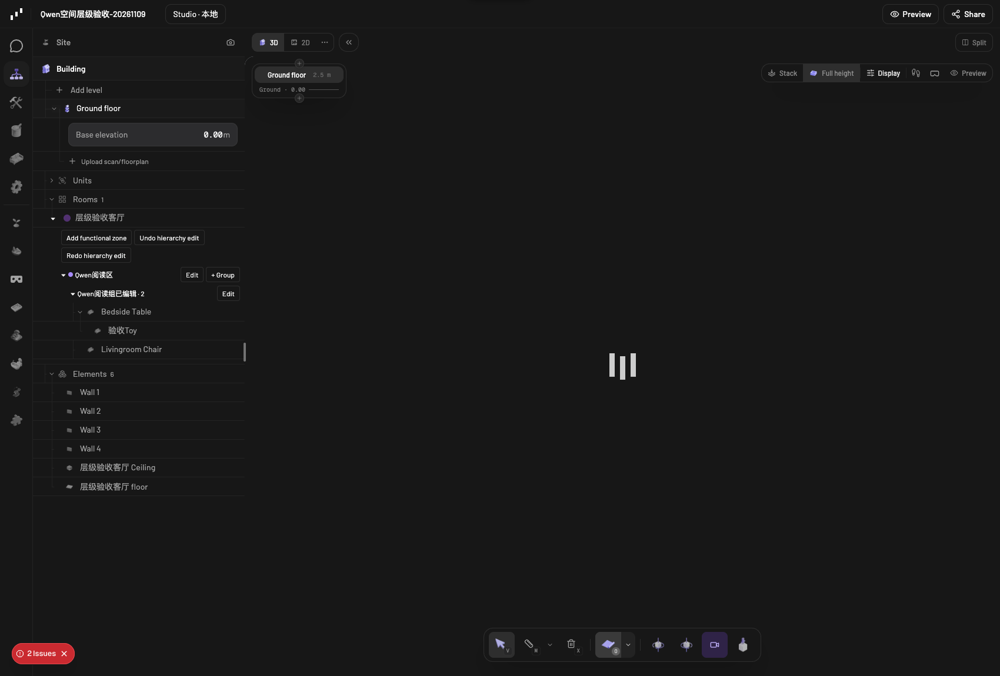
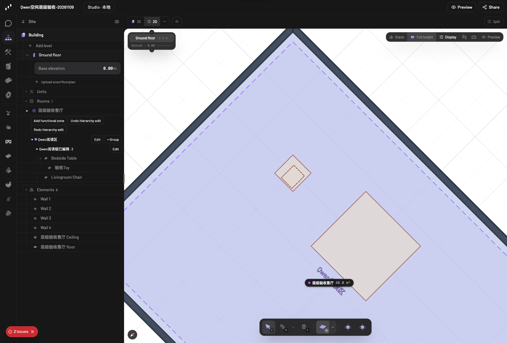

# 独立功能分区与家具组团

基线：`ea96d4aeaf52fde7b31fe280f24fc9dbba33eba9`。分支：`codex/spatial-hierarchy`。

本次新增两种独立场景对象，在 Scene 面板按 **房间 → 功能分区 → 家具组团 → 家具** 逐级展开，包含家具上承托的物品；Collection 保持原有用途。

## 数据与保存

| 类型 | 核心字段 |
|---|---|
| `functional-zone` | `roomId`、`name`、`functions`、`polygon`、`color` |
| `furniture-group` | `functionalZoneId`、`name`、`purpose`、`memberIds`、`anchorNodeId`、`memberRoles` |

两类对象都是独立的原生场景节点，物理 `parentId` 指向所在楼层，语义归属使用上述引用字段。家具的 `parentId`、局部变换和资产不因分区或组团创建而改变。房间树按语义关系展示，承托物继续沿真实家具层级展开。房间内已展示的家具不再重复列在通用 Elements 下。

这沿用原生 AnyNode、场景存储、SSE 同步、导出、复制和撤销机制；无需增加另一套顶层场景存储通道。旧项目加载后不自动生成分区或改变布局。完整场景复制会重映射房间、分区、组团成员、锚点和角色引用。

## 网页操作

1. 打开项目，点击左侧 **Scene**，展开房间。
2. 点击 **Add functional zone**，填写名称和功能，逐点编辑 X/Z 边界，保存。初始边界采用房间轮廓，不生成墙体、楼板或天花；分区可重叠，边界不能越出房间或覆盖房间孔洞。
3. 在分区下点击 **+ Group**，选择已有家具成员、角色与锚点，保存。未整理的家具仍显示在 Unassigned/Ungrouped furniture 下。
4. 编辑组团，填写 ΔX、ΔZ 米和角度，点击 **Apply group transform**。先绕锚点旋转，再平移；也可只设置其中一项。
5. **Undo hierarchy edit / Redo hierarchy edit** 使用原生编辑历史。刷新后关系和家具变换仍保存。

2D 显示分区虚线和透明填色，3D 与房间树使用同一份数据。新文案使用 Pascal i18n；中文、法文、西文和日文新增译文标为 AI 待审稿，遵循原有编译策略，未审核内容使用英文回退。

## 整体变换与边界

- 首版成员是 `item` 家具实例，包含目录家具和本地 Studio 的 TRELLIS / Qwen＋Blender 模型；原生 cabinet/shelf 等其他节点种类不作为组团成员。
- 一个家具实例只能属于一个显式组团，承托祖先与子物品也不能分别受不同组团控制。
- 仅变换所选成员中的承托根节点；子物品随宿主运动，其局部坐标、旋转、缩放和父节点不被重复改写。
- 单独选中外部宿主上的物品时，整体变换会拒绝并提示加入其落地宿主。锚点若是组内承托物，会按宿主缩放与旋转计算楼层坐标。
- 删除组团只解除组团；删除功能分区同时解除其组团记录，保留家具。
- 成员归属是显式关系，移动后不会静默改组。查询会报告越出分区及失效引用；整体变换不自动求解碰撞、通道净空或重排家具。

## Qwen / MCP 工具

| 工具 | 用途 |
|---|---|
| `get_spatial_hierarchy` | 房间、分区、组团、家具与归属问题 |
| `list_functional_zones` | 查询功能分区 |
| `list_furniture_groups` | 查询家具组团 |
| `edit_functional_zone` | 创建、编辑、删除功能分区 |
| `edit_furniture_group` | 创建、编辑、解除家具组团 |
| `transform_furniture_group` | 整体平移与旋转 |

工具契约在 core/agent-tools，纯操作在 core/agent-operations，MCP 和网页执行相同操作。本地 Qwen 可自主发现三个编辑工具；层级查询首轮即可调用。编辑工具属于“房间与门窗”插件，遵守现有插件启用设置。

## 实际验收

- 原生 schema、解析器、操作、历史与 MCP 契约等五个测试文件：**479 项通过**。
- 节点注册、工具契约纯度及树路由：**7 项通过**。
- 网页真实创建、编辑、展开/收起、整体平移 `[1,2]` 米、旋转 90°、撤销/重做、刷新和 2D/3D 切换通过；所有保存响应为 200。
- 本地 Qwen3.8 27B 实际创建分区和组团、编辑名称用途、整体旋转 30° 并平移 `[0.3,0.2]` 米，再调用 undo 撤销变换；桌椅原位恢复，Toy 局部姿态和父节点保留。
- Qwen 编辑结果刷新后在网页树中正确显示；已有 **14 个项目的 graph 完全未变**。
- core/MCP/nodes 构建、编辑器与网页类型检查通过；启动脚本按所选分支增量构建，防止切换分支后继续使用旧 dist。

测试入口和小型回执在 `local-ai/hierarchy-tests/`。原始项目快照、聊天历史、生成素材及详细运行日志保留本机，不上传。

国际化检查的目录同步、新节点登记及新面板文案扫描通过。全仓 `i18n:check` 仍因基线已有的 local-chat、local-studio、local-studio-preview、editor-navbar 中文字面量而失败；`i18n-report.json` 记录实际涉及文件并确认这些文件相对基线未改。未绕过该检查或扩大字面量允许名单。

开发验证时曾出现 Next 开发缓存的 `HMR hash mismatch` 刷新循环；保留旧缓存并重建后，网页完整验收通过。3D 场景切换仍可能出现基线 React/drei 的同步 unmount 控制台警告；本次网页测试没有未处理的 pageerror。

## Interaction update

The permanent tree buttons have been replaced by context menus, inspector cards, direct transform handles and semantic drag/drop. See [the interaction update and acceptance evidence](SPATIAL-HIERARCHY-UX.md).
